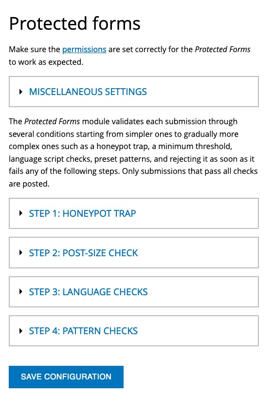

## Description

**Protected Forms** is a lightweight, non-intrusive spam-protection
module that rejects all non-admin form submissions that either trigger
the honeypot trap, fail to meet the minimum threshold, or contain
disallowed language scripts or preset patterns.

## How it works

If a user submits content that triggers a honeypot field, is shorter
than the configured minimum threshold, or contains a trigger pattern in
the name, subject, body, or any other *textarea* or *textfield* field,
the submission is rejected and a preset error message is displayed.

Roles can be configured to bypass the *Protected Forms validation*.

The number of rejected submissions is displayed on the **Reports \>
Status report** (`admin/reports/status`) page.

Rejected messages are logged and can be viewed on the **Reports \>
Recent log messages** (`admin/reports/dblog`) page.

If the [IP address
blocking](https://backdropcms.org/project/ip_blocking) module is
enabled, you can set a threshold for spammers to be automatically
banned.

## Installation

Download and place the recommended version of the module in your
website's modules directory, then go to the\
**Functionality** page (`/admin/modules`) and enable the **Protected
Forms** module.

Alternatively, if you have
[Bee](https://github.com/backdrop-contrib/bee) installed, run the
following command on the CLI:

    bee -y en protected_forms

## Configuration

Go to the **Protected Forms** configuration page
(`/admin/config/content/protected_forms`), set the allowed language\
scripts, the rejection message text, and the trigger patterns for
rejection.

If you want to protect only anonymous submissions, go to the
**Permissions** page\
(`/admin/people/permissions#module-protected_forms`) and check the box
for the authenticated user role next to the\
*Bypass Protected Forms validation* option.

## Troubleshooting

Report all issues at\
https://github.com/backdrop-contrib/protected_forms/issues.

## Credits

The [Protected Forms](https://www.drupal.org/project/protected_forms)
module was originally created for Drupal and later ported to Backdrop by
the [AltaGrade](https://www.altagrade.com) team.
